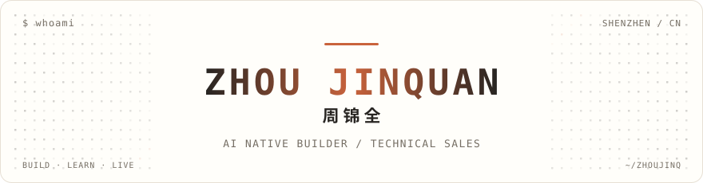
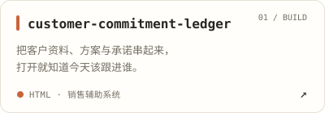
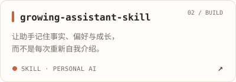
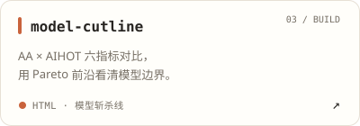
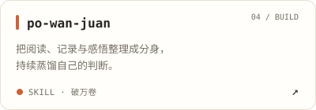
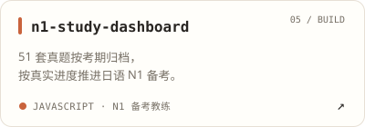
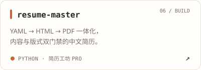
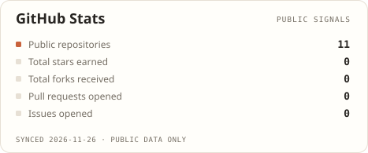
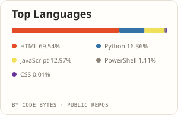

  <picture>
    <source media="(prefers-color-scheme: dark)" srcset="assets/banner-dark.svg">
    
  </picture>

Building useful tools with AI, starting from real problems in work and life. 用 AI 改造自己的工作，把一个个想法做成真正能用的工具。

Communication engineering, former CV algorithms, now overseas technical sales. 通信工程科班出身，做过 CV 算法；现在是一个把 AI 用进销售动作里的人。

Learning by building. Keeping a life beyond the screen. 保持好奇，边学边做，也认真生活。

  <picture>
    <source media="(prefers-color-scheme: dark)" srcset="assets/stack-dark.svg">
    
  </picture>

<a href="https://zhoujinq.github.io/">zhoujinq.github.io</a> · <a href="https://github.com/zhoujinq?tab=repositories">Projects</a> · <a href="mailto:2336097716@qq.com">Email</a>

<h2 align="center">Projects · 项目</h2>

  <a href="https://github.com/zhoujinq/customer-commitment-ledger"><picture><source media="(prefers-color-scheme: dark)" srcset="assets/cards/pin-customer-commitment-ledger-dark.svg"></picture></a>
  <a href="https://github.com/zhoujinq/growing-assistant-skill"><picture><source media="(prefers-color-scheme: dark)" srcset="assets/cards/pin-growing-assistant-skill-dark.svg"></picture></a>

  <a href="https://github.com/zhoujinq/model-cutline"><picture><source media="(prefers-color-scheme: dark)" srcset="assets/cards/pin-model-cutline-dark.svg"></picture></a>
  <a href="https://github.com/zhoujinq/po-wan-juan"><picture><source media="(prefers-color-scheme: dark)" srcset="assets/cards/pin-po-wan-juan-dark.svg"></picture></a>

  <a href="https://github.com/zhoujinq/n1-study-dashboard"><picture><source media="(prefers-color-scheme: dark)" srcset="assets/cards/pin-n1-study-dashboard-dark.svg"></picture></a>
  <a href="https://github.com/zhoujinq/resume-master"><picture><source media="(prefers-color-scheme: dark)" srcset="assets/cards/pin-resume-master-dark.svg"></picture></a>

<h2 align="center">Stats · 数据</h2>

  <picture><source media="(prefers-color-scheme: dark)" srcset="assets/cards/stats-dark.svg"></picture>
  <picture><source media="(prefers-color-scheme: dark)" srcset="assets/cards/top-langs-dark.svg"></picture>

  <picture>
    <source media="(prefers-color-scheme: dark)" srcset="assets/snake-dark.svg">
    
  </picture>

Stay curious. Build things. Live well. 保持好奇，边学边做，也认真生活。

